<!-- Generated from profile.json by scripts/build_profile.py. Edit the config, then rebuild. -->

  

<a href="https://www.kaggle.com/mann14">Kaggle</a> &nbsp; / &nbsp; <a href="https://github.com/Mann-Raval">GitHub</a> &nbsp; / &nbsp; <a href="https://github.com/Mann-Raval?tab=repositories">Explore my work ↗</a>

---

### Hey, I'm Mann Raval 👋

I build machine learning projects and web applications. My work spans document Q&amp;A with RAG, recommendation systems, image classification, and real-time tools for managing projects.

**A few things you'll find here**

- Experiments with data and machine learning.
- Projects that connect models to usable interfaces.
- Web applications built around practical workflows.

 

## 🛠️ Tech stack

<h3 align="center">💻 Full Stack Development</h3>

<h3 align="center">🧠 Machine Learning &amp; Data</h3>

<h3 align="center">⚙️ Project Tools &amp; Infrastructure</h3>

## 🐍 Watch my contributions get eaten

<picture>
  <source media="(prefers-color-scheme: dark)" srcset="assets/github-snake-dark.svg" />
  
</picture>

## 📊 GitHub statistics

<a href="https://github.com/Mann-Raval?tab=repositories">Explore my projects →</a>

## 🤝 Let's connect

Explore my projects, follow along on GitHub, or find my data science work on Kaggle.

<a href="https://www.kaggle.com/mann14">Kaggle</a> &nbsp; / &nbsp; <a href="https://github.com/Mann-Raval">GitHub</a>

